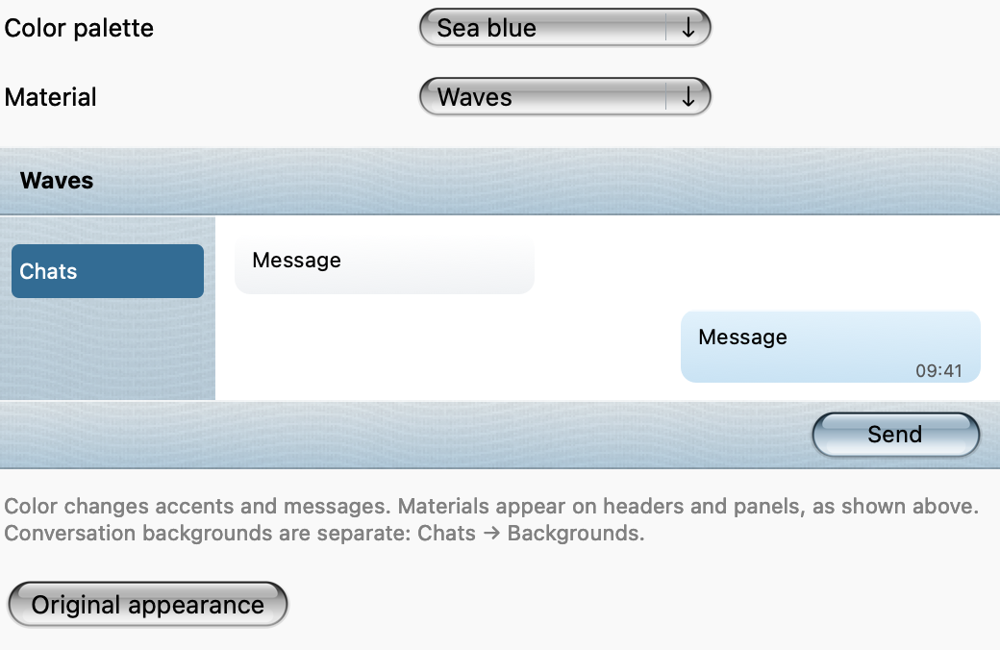
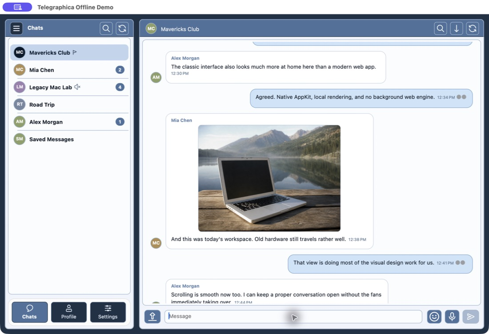

  
  <h1>Telegraphica</h1>
  
<b>For the Intel Macs that still have plenty of life left in them.</b>

  

    
    
    
    
  

  

    <a href="https://github.com/MiChiRose/telegraphica/releases/latest"><b>Download Telegraphica</b></a>
    · <a href="https://t.me/macos_telegraphica">News on Telegram</a>
    · <a href="https://github.com/MiChiRose/telegraphica/issues">Report a problem</a>
  

## A personal note

I started Telegraphica to help people keep using the Macs they love. Behind
it are many hours of development, testing, design work, and care for the small
details. Seeing that work copied, renamed, and presented as somebody else's
original development is disheartening. The hardest part is the time and
effort that disappear behind somebody else's name.

That is why source development for future releases, starting with **0.6.3**,
is maintained in a private repository. This public page remains the home for
Telegraphica's downloads and updates.

I am happy to share the source code free of charge with people who contact me
first. Please write to me to discuss access and the intended use; the source is
not being offered as a public download or under a new blanket license.

I am always open to a conversation and to working together. If you would
like to discuss development, source access or a collaboration, please
[email me](mailto:yura.menschikov@icloud.com) or reach out through the
[Telegram channel](https://t.me/macos_telegraphica).
Please respect authorship: copying the project, changing its name, and
claiming the work as your own crosses a line.

— **Yura Menschikov**, creator of Telegraphica

---

## An older Mac can still be a good place to talk

Telegraphica is an independent, unofficial Telegram client for
**OS X 10.8 Mountain Lion through macOS 10.13 High Sierra** on Intel Macs.
It brings everyday conversations to older hardware, with a choice of
**Classic** and **Aqua** appearance. It is not affiliated with Telegram.

- Private conversations, groups, channels, folders, and forum topics.
- Photos, voice messages, stickers, media browsing, and downloads.
- Replies, reactions, pinned messages, and scheduled sending.
- Local chat backgrounds, colors, textures, and your own images.
- Optional Workshop modules for a few extra things to explore.

Telegraphica is an **open beta**. Some features have limitations on older
systems, and there are still rough edges to improve.

## New in 0.6.4: Aqua with a choice

Choose **Glass Aqua**, **Mavericks** or **High Sierra** controls in
**Settings → General → Aqua appearance → Controls**. Buttons, dropdowns,
Settings navigation, chat search and folder rows follow the selected finish.
The change applies immediately, independently of your colors and materials.
Padding, caption alignment and compact chat tools have been refined throughout.

- Local text drafts survive navigation and restarts in an authenticated encrypted
  store; a red pencil marks chats with unsent text.
- Edited messages display a small localized “(edited)” label beside their time.
- Sticker search supports words on the normal TDLib runtime; previews load
  correctly and Aqua thumbnails no longer sit on circular glass backdrops.
- Workshop gains local search, clearer details/status, better narrow layouts and
  background installation/verification with safer cancellation.
- Update downloads and diagnostics receive additional bounds and failure checks;
  Workshop checks installed module files before loading them.

Independent publisher-signed application updates are not enabled in this release.
The local draft store does not encrypt every file used by the application.

[Read the 0.6.4 release notes](https://github.com/MiChiRose/telegraphica/releases/tag/v0.6.4).

## Aqua, your way

Aqua includes seven color palettes, eight surface materials and three control finishes,
system-style Settings and local chat backgrounds. Classic remains available.

  

<em>Aqua's appearance preview: colors and materials can be combined.</em>

To enable Aqua, open **Settings → Appearance → Interface → Aqua** and confirm
the restart. In Aqua, colors and materials are under **Settings → General →
Aqua appearance**, including **Controls → Glass Aqua / Mavericks / High Sierra**.
Conversation backgrounds are separate: **Settings → Chats →
Change background…**. Classic remains available in the same interface selector.

<b>A look at Classic</b>

  

An offline demo with sample conversations. Classic is still part of Telegraphica.

## Download and install

One application covers **OS X 10.8–macOS 10.13, Intel x86_64**.

| Download | What to choose |
| --- | --- |
| [0.6.4 DMG installer](https://github.com/MiChiRose/telegraphica/releases/download/v0.6.4/Telegraphica-v0.6.4-macos10.8-10.13-x86_64.dmg) | Open it and drag Telegraphica into Applications. |
| [0.6.4 application ZIP](https://github.com/MiChiRose/telegraphica/releases/download/v0.6.4/Telegraphica-v0.6.4-macos10.8-10.13-x86_64.app.zip) | The same application in a ZIP archive. |
| [Release notes and SHA-256 checksums](https://github.com/MiChiRose/telegraphica/releases/latest) | Read about the update and verify your download. |

If macOS blocks first launch, Control-click the application and choose **Open**.
When updating, quit Telegraphica before replacing it. Keep your existing
application data and settings; there is no need to delete your session.

Local text drafts are now restored after navigation and restart. Files selected
for attachment are not preserved as draft uploads.

## Staying up to date

While running, Telegraphica checks for updates once an hour and adds an
indicator in Settings when an update is available. Updates are not installed
automatically. You can also choose **Settings → Check for updates**.

The public repository contains project information, README illustrations,
ready-to-use application releases, and Workshop downloads. Source code and
development history are maintained privately.

[News and discussion on Telegram](https://t.me/macos_telegraphica) ·
[Email the author](mailto:yura.menschikov@icloud.com) ·
[Report a problem](https://github.com/MiChiRose/telegraphica/issues)

Aqua preview texture: “Wavecut” by Ian Soper, [Subtle Patterns](https://www.toptal.com/designers/subtlepatterns/wavecut/), [CC BY-SA 3.0](https://creativecommons.org/licenses/by-sa/3.0/).
